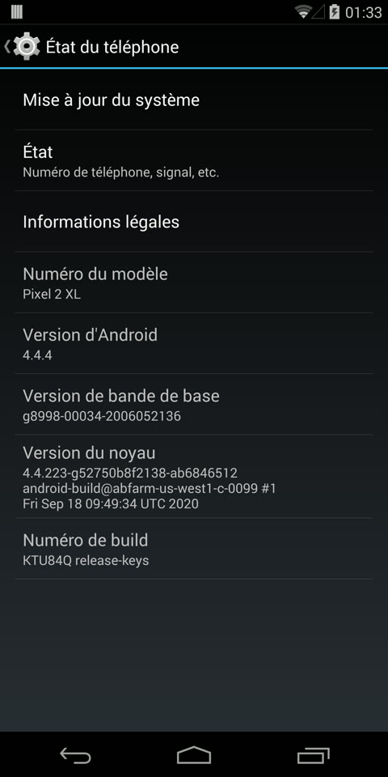
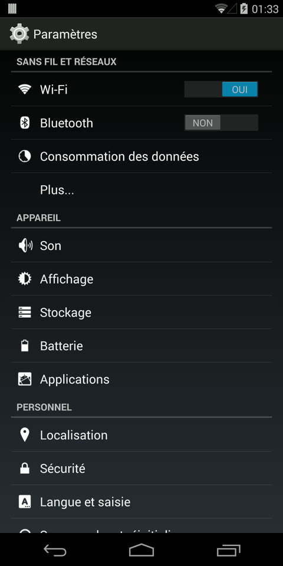

# Taimen KitKat: Android 4.4.4 on the Pixel 2 XL

Android 4.4.4 KitKat (AOSP `android-4.4.4_r2`, KTU84Q) running on the **Google Pixel 2 XL**
(`taimen`, Snapdragon 835 / msm8998). The phone launched with Android 8 in 2017; this port runs
a 2014 userspace on top of the phone's **stock Android 11 kernel and firmware**, with real
hardware acceleration: the actual Adreno 540 driver, the Qualcomm camera stack, the modem, the
sensor DSP, GPS and NFC all work.

There is no kernel source change and no rebuilt vendor code. KitKat talks to the Android 11
drivers through two bridges written for this port:

- **libhyb**, a small ELF loader that loads Android 11 32-bit libraries (Adreno GLES driver,
  QTI gralloc, camera HAL, OMX codecs) straight into KitKat processes;
- an **Android 11 chroot** (`/system/v11`) that runs the 64-bit Qualcomm daemons (modem, wifi,
  sensors, GNSS, NFC), with small bridge daemons that serve them to KitKat HALs over sockets.

<p align="center">
  
  
  
</p>

- [Status](#status)
- [Install](#install)
- [How it works](#how-it-works)
- [Every hack, from boot to camera](#every-hack-from-boot-to-camera)
- [Building](#building)
- [Repository layout](#repository-layout)
- [Credits and licenses](#credits-and-licenses)

## Status

| Works | Notes |
|---|---|
| Boot, setup wizard, Google Play | Open GApps 4.4 nano in the release build |
| Display, touch, hardware GPU (OpenGL ES 3.2, Adreno 540) | zero-copy presentation, hwui on, games run (landscape included) |
| Wifi | stock `wlan.ko`, firmware in the modem |
| Bluetooth | WCN3990 bring-up through a custom `libbt-vendor` |
| Audio | speaker, earpiece, microphones |
| Sensors | accelerometer, gyroscope, compass, barometer, light, proximity, step counter, auto brightness |
| Camera (back and front) | Android 11 Qualcomm HAL3 translated to KitKat's HAL3 3.0; low preview framerate |
| Hardware video codecs | Venus decoder/encoder, HEVC playback added to KitKat |
| GPS | modem GNSS engine over QMI LOC, XTRA assistance |
| NFC | reading and writing tags (NXP PN553) |
| USB | MTP, adb (Developer options), charging |
| Games of the time | Angry Birds, Jetpack Joyride, Subway Surfers, Temple Run, Fruit Ninja... (see below) |
| Vibration, notification LED, flash/torch, battery, thermal readings | |

| Partial / untested | |
|---|---|
| Cellular | reference RIL over the modem AT port: SIM, network registration; calls, SMS and mobile data had little testing |
| Camera | ZSL and HDR+ are disabled; video recording had little testing |
| Home screen | the default digital clock widget is not placed on first boot, and the search bar shows no icons |

| Not working | |
|---|---|
| Fingerprint | the sensor needs the Android 11 TEE/keymaster stack |
| NFC card emulation, secure element | |
| Pixel Visual Core (HDR+), Active Edge, always-on display | |
| Encryption, SELinux (disabled), OTA updates | |

## Install

Short version for a phone with an unlocked bootloader:

1. Flash Google's factory image **RP1A.201005.004.A1** (Android 11) to **slot A**. KitKat uses
   its kernel, bootloader, radio and DTBO.
2. Flash `boot_a` and `system_a` with the fastboot package of the
   [release](https://github.com/DoomGuy41/Taimen-KitKat/releases) (`flash-all.sh` / `.bat`).
3. Format userdata (the script does it) and boot.

The full step-by-step guide, from a stock phone, is in **[FLASHING.md](docs/FLASHING.md)**.

## How it works

```
 ┌──────────────────────────── KitKat 4.4.4 userspace (32-bit) ────────────────────────────┐
 │ apps · system_server · SurfaceFlinger · mediaserver · bluedroid · rild · NfcNci          │
 │                                                                                          │
 │  KitKat HALs written for this port:                                                      │
 │   gralloc.taimen  libEGL/GLES_adreno  camera.taimen  libstagefrighthw  ← libhyb loads    │
 │                                                       Android 11 32-bit vendor libs      │
 │   sensors.taimen  gps.taimen  nfc_nci.taimen          ← sockets to the chroot bridges    │
 │   audio.primary.taimen  lights.taimen  libbt-vendor   ← direct kernel interfaces         │
 ├──────────────────────── /system/v11: Android 11 chroot (64-bit) ─────────────────────────┤
 │  rmt_storage · tftp_server · pd-mapper · cnss-daemon   (modem + wifi firmware)           │
 │  sensors.qcom + sensorbridge · gnssbridge (QMI LOC) · nfcbridge (NXP HAL) · bootmark     │
 ├────────────────────────── stock Android 11 kernel 4.4 (64-bit) ──────────────────────────┤
 │  stock modules, firmware, modem/ADSP/SLPI/Venus/Adreno, unchanged except one string      │
 └──────────────────────────────────────────────────────────────────────────────────────────┘
```

Everything proprietary comes from Google's factory image and is extracted at build time
(`scripts/extract-blobs.sh`). This repository only holds code.

## Every hack, from boot to camera

### Booting KitKat on an A/B device with a 4.4 kernel

- **Kernel: one renamed string.** On A/B Pixels the bootloader always passes `skip_initramfs`,
  and the kernel then ignores the ramdisk and mounts `system` as root. KitKat needs its ramdisk.
  The stock kernel is decompressed, `skip_initramfs` is renamed to `want_initramfs`, and the
  image is recompressed (`scripts/patch-kernel.py`). The bootloader keeps adding the parameter,
  but the kernel no longer recognizes it. The recompressed kernel **must use the LZ4 frame
  format**, like the stock one: with the legacy LZ4 format (`lz4 -l`), the bootloader silently
  refuses the boot partition and stays in fastboot, without even counting a boot attempt.
- **Command line too long for KitKat's init.** The Pixel 2 passes more than 1024 bytes, so
  `androidboot.slot_suffix` and `androidboot.serialno` were cut off. The buffer is now 4 KiB.
- **No by-name links.** KitKat's ueventd does not create `/dev/block/bootdevice/by-name`, so
  `fstab.taimen` uses device nodes directly (`system_a` = sda7, `userdata` = sda13). This is why
  the port is tied to slot A. `v11.sh` creates the by-name links later for the Qualcomm daemons.
- **No cache partition.** `/cache` is a tmpfs.
- **64-bit binder.** The kernel only speaks the 64-bit binder ABI. KitKat's libbinder,
  servicemanager and bionic's `binder.h` use the 64-bit layout even in 32-bit processes (patches
  from retro-android-ports).
- **No logger driver.** `/dev/log/*` is gone from 4.4. liblog falls back to `/dev/kmsg`
  (`<level>Tag[pid]: message`, newline-terminated, or the kernel merges lines), so `dmesg` is
  the logcat.
- **No `/dev/alarm`.**
  - AlarmManagerService uses one timerfd per alarm type on `CLOCK_*_ALARM` (as Lollipop does),
    plus a `TFD_TIMER_CANCEL_ON_SET` timerfd to detect wall-clock changes.
  - `SystemClock.elapsedRealtime()` uses `CLOCK_BOOTTIME`.
  - The zygote sets capabilities with the 64-bit `capset` ABI, so system_server keeps
    `CAP_WAKE_ALARM` and `CAP_BLOCK_SUSPEND`.
  - `setCurrentTimeMillis` uses `settimeofday`.
- **Read-only RTC.** The PM8998 RTC refuses writes. system_server stores the offset between wall
  time and the RTC in `/data/system/time/rtc_offset`, and `rtc-restore.sh` re-applies it at boot.
- **Boot counting.** The bootloader decrements a retry counter until the OS reports a successful
  boot, then switches slots. `bootmark` runs in the chroot and calls `markBootSuccessful` of the
  Android 11 `bootctrl.msm8998` HAL. The HAL reads `ro.boot.*` properties that KitKat does not
  set, so bootmark exports its own `property_get` that reads `/proc/cmdline`.
- **ext4 project quota.** If another Android on the other slot formatted `userdata`, the
  `project` feature makes the stock kernel refuse the mount. fs_mgr clears the flag on `/data`.
- **Thermal zones.** `thermal_zone0..3` belong to the powered-off Pixel Visual Core and return
  EIO, which breaks CPU temperature apps. The SoC sensors are bind-mounted over them.
- **Bring-up leftovers kept on purpose.** servicemanager, ueventd and healthd are not
  `critical` in `init.rc`, as during bring-up.

### libhyb: loading Android 11 libraries into KitKat processes

The Adreno driver, the QTI gralloc, the camera HAL and the OMX codecs only exist as Android 11
binaries. They are 32-bit ARM, like KitKat, but they need a newer bionic, newer libc++, HIDL and
many symbols KitKat lacks. **libhyb** (`device/google/taimen-kk/hyb`) is a custom ELF loader
for them, inside KitKat processes:

- **Loader features.** It maps the `PT_LOAD` segments itself and handles RELRO, REL, Android
  packed (`APS2`) and RELR relocations, SysV and GNU hash tables, symbol versions, init arrays,
  `PT_ARM_EXIDX` for C++ exceptions, `dladdr` and `dl_iterate_phdr`.
- **Symbol resolution order.**
  1. hooks;
  2. the library's local group: its dlopen root, then the dependencies breadth-first, as the
     Android linker does;
  3. all loaded Android 11 libraries;
  4. KitKat's libc/libm/libdl/liblog/libcutils/libz.

  The local group was required: the camera modules define a global `g_cam_log` with different
  sizes, and binding to the wrong copy corrupted memory. A **gdbserver hardware watchpoint**
  (`camwatch.sh`) found the writer. Linking only starts once the whole dlopen tree is mapped, so
  every group is complete.
- **hooks.c.** These are the functions Android 11 libraries import that KitKat lacks or
  implements differently:
  - fortify `_chk` functions;
  - locales;
  - `pthread_cond` with `CLOCK_MONOTONIC`;
  - recent liblog;
  - `property_get_*` (a NULL key used to crash KitKat);
  - `native_handle_*`, `ashmem_valid`, fdsan, atrace no-ops;
  - `access`/`realpath` that redirect `/vendor/lib...` to `/system/a11`.

  `scripts/dev/closure.py` lists exactly what is missing for a given set of libraries.
- **No binder services.** HIDL `getService` and `AServiceManager_getService` return "no
  service" right away. The camera's power client would otherwise wait forever.
- **Binary patch.** `libbinder.so` of Android 11 waits 5 s for every missing service on each
  camera open. A 4-byte patch (`movw r5, #5000` → `#0`) is applied at load time, only if the
  original bytes match.
- **GL aliases.** Android 11's `libEGL`/`libGLESv*` loaders would look for their driver through
  Android 11 properties and abort, so the Adreno libraries are served under those names.
- **Debugging.** `HYB_TRACE_SYM=<symbol>` logs who resolves a symbol, and where.

### Graphics

- **EGL/GLES shims.** `libEGL_adreno`/`libGLESv2_adreno` are thin KitKat-side libraries:
  - generated jump tables forward every GL call to the real driver;
  - `eglCreateWindowSurface` wraps KitKat's `ANativeWindow` and translates the Android 11
    query/perform codes;
  - buffers are presented to the driver in the Android 11 layout (64-bit usage, layer count).
- **Rotated landscape games.** The driver pre-rotates when the transform hint is 90°, with
  swapped buffer sizes and an inverse transform KitKat cannot follow. The shim answers `0` to
  `NATIVE_WINDOW_TRANSFORM_HINT`; SurfaceFlinger composes in GL, so rotation is free there.
- **gralloc.taimen.** This is KitKat's gralloc on top of the Android 11 QTI gralloc1, so buffers
  are real ION buffers in the layout the GPU expects. Buffers received over binder are imported
  as clones, because the QTI import keeps the handle and later frees it.
- **Zero-copy display: fbpresentd.** The panel is a command-mode DSI panel behind MDSS.
  SurfaceFlinger's buffer becomes the only layer of the DMA0 pipe through an MDSS atomic commit,
  as the stock composer does. The ioctl's 32-bit compat path crashes the kernel, so the commit
  is made by a small **64-bit** daemon that receives buffers over a socket (`SCM_RIGHTS`).
- **Kernel panic when switching paths.** Switching back to the copy + pan fallback with a layer
  still attached panicked the kernel. fbpresentd now sends an empty commit when its client
  disconnects.
- **hwui was silently off.** The mere *presence* of the `ro.kernel.qemu` property disables hwui
  in KitKat, whatever its value. Removing it brought hardware UI rendering back, and with it
  TextureView, which the camera app needs.
- **Smaller fixes.**
  - hwui's GL version is capped at 2.0.
  - `config.disable_atlas` is backported from Lollipop.
  - SystemUI falls back to a canvas wallpaper when ES2 is unavailable.
  - gralloc's framebuffer stride comes from the kernel's `line_length`.
- **Earlier dead end: glrenderd.** The first working graphics path forwarded GL calls to a
  renderer in an Android 11 chroot, the emulator way (retro-android-ports). It worked but was
  slow. libhyb replaced it.

### Modem and wifi: an Android 11 chroot

- **The chroot.** `/system/v11` holds the Android 11 64-bit bionic, linker and the Qualcomm
  daemons: `rmt_storage` (modem EFS), `tftp_server`, `pd-mapper`, `cnss-daemon`, `irsc_util`.
  `hwchroot` (from pdx203-jellybean) enters it in a private mount namespace.
- **`v11.sh` startup sequence.**
  - It mounts the modem partition and `/persist`.
  - It applies the IPC router security rules; without them, non-root QMI clients hang.
  - It boots the modem by holding `/dev/subsys_modem` open, pointing the firmware loader at the
    modem partition only while the modem boots.
  - It loads the stock `wlan.ko` (the wifi firmware lives in the modem).
  - It sets the baseband version shown in *About phone* from the radio image.
- **pm-service shim.** cnss-daemon talks to pm-service over vndbinder, which does not exist
  here. A 30-line `libperipheral_client.so` replacement simply says "online".
- **Logs.** The daemons log to Android 8+'s `logdw` socket. A tiny `logdw` receiver copies
  warnings and errors to the kernel log. tftp_server floods it otherwise.
- **wifi HAL.** `wifi_load_driver` waits for `wlan0`, since the driver is loaded outside the HAL.

### Cellular

The reference RIL drives the modem's AT port (`/dev/at_mdm0`):

- `AT+GSN` replaces `AT+CGSN`, which never completes on this modem;
- every AT command gets a 15 s timeout;
- the SIM state is remembered across boots (`persist.radio.taimen_sim`) and reported as absent
  while the radio is off, so KitKat does not show "SIM removed" at boot.

### Bluetooth

`libbt-vendor` brings up the WCN3990 over `ttyHS0` itself:

- **Power control.** The chip is powered by *baud-rate pulses* on the UART TX line: `0xC0` at
  2400 baud means off, `0xFC` at 115200 means on.
- **Firmware.** It downloads the rampatch and NVM with Qualcomm's EDL protocol.
- **Speed.** The NVM asks for 3.2 Mbit/s, which termios cannot do, so it is rewritten to
  3 Mbit/s.
- **In-band sleep.** It is disabled, because bluedroid's H4 does not know IBS bytes.

### Audio

- `audio.primary.taimen` is a tinyalsa HAL. It routes MultiMedia1 to QUAT_MI2S to the two
  TAS2557 amplifiers, and the WCD9340 digital microphones to SLIM_0_TX.
- The amplifier calibration is linked from `/persist`.
- The ADSP is booted from init; the sound card appears afterwards.

### Sensors

- The SLPI (sensor DSP) is booted, then the Android 11 `sensors.qcom` and the Qualcomm sensor
  HAL run in the chroot. `sensorbridge` serves the HAL to KitKat's `sensors.taimen`.
- Only one sensor is kept per KitKat type (non-wake-up preferred). For steps, the IMU's hardware
  pedometer is used.
- KitKat flushes a sensor before enabling it, which the Qualcomm HAL refuses for inactive
  sensors, so the KitKat HAL produces the "flush complete" event itself.
- The KitKat HAL reconnects and replays its state if the bridge restarts.

### GPS

- `gnssbridge` talks to the modem's **QMI LOC** service through `libqmi_cci` with raw TLV
  messages, encoded and decoded by hand from libqmi's service description. Qualcomm's whole
  location stack (`libloc_api_v02`, izat) is avoided.
- The service object values were read from `libloc_api_v02.so`.
- Satellites count as tracked when they have a valid SNR. The QMI state field turned out to be
  unusable, and decoding it gave "fake" satellites.
- XTRA predicted orbits are downloaded by KitKat's GpsLocationProvider (`gps.conf`) when the
  modem asks, then injected in 1 KiB parts.

### NFC

- `nfcbridge` loads the Android 11 NXP HAL (`nfc_nci_nxp.so`, PN553) in the chroot. Its
  `phNxpNciHal_*` functions are C++ with plain arguments, so they are called by their mangled
  names.
- The NXP libraries look for the secure element through HIDL and would wait forever for
  `hwservicemanager`. The executable exports its own `getRawServiceInternal` (`-rdynamic`),
  which wins over libhidlbase's.
- **NCI 2.0 vs 1.0.** The PN553 speaks NCI 2.0, KitKat's stack NCI 1.0. The bridge translates
  `CORE_RESET` (2.0 splits it into a response and a notification) and `CORE_INIT`. The rest of
  the protocol is the same, and the NXP HAL still gets the original 2.0 `CORE_INIT_RSP`.
- `libnfc-brcm.conf` (KitKat's config name) disables the secure element and P2P listening.

### Camera: the hardest part

KitKat's camera service expects a module 2.0 with HAL3 **3.0** devices. The Android 11 HAL is
device 3.5. `camera.taimen` sits between the two.

- **Metadata.** The binary layouts differ, and the tag numbers too: Android 11 removed two
  sections, which shifted everything after them. Entries are copied one by one, with tags
  matched by **name**. Vendor tags and tags unknown to KitKat are dropped.
- **Legacy keys and limits.** The old static keys KitKat reads (JPEG sizes, processed/raw
  durations) are rebuilt from `availableStreamConfigurations`. `maxRegions` is forced to 1.
- **Vendor tags.** They are registered with `set_camera_metadata_vendor_ops`, as Android 11's
  camera provider does. Otherwise the HAL cannot write its own entries ("Unknown tag").
- **Requests.** KitKat sends partial settings, so they are merged into the HAL's template; the
  preview 3A does not start without that.
- **Session parameters.** They are mandatory. Without them, mm-camera never gets the HAL version
  and capture intent: the sensor has no mode, the ISP has no resources and no stream links.
- **Streams.** Android 11's `camera3_stream_t` is longer, so each KitKat stream has a twin.
- **Results.** Android 11 sends partial results and may return buffers before the shutter
  notification. KitKat wants one metadata buffer per frame, in order, after the shutter. Results
  are merged, queued and delivered in order.
- **Easel.** The rear camera's MIPI path goes through the **Pixel Visual Core** (Easel). The
  camera HAL must be able to open `mnh_sm`, and the Easel firmware must be present, or the
  sensor never produces a start of frame.
- **Disabled features.** ZSL and HDR+ are disabled.
- **Debugging.** A double free in device close was found along the way. `camtest` (eng builds)
  drives the Android 11 HAL directly.

### Video

`libstagefrighthw` exposes the Venus codecs through the Android 11 OMX core loaded by libhyb.
The OMX structures are the same in both versions. KitKat learned HEVC: the MP4 `hvc1`/`hev1`
boxes, Matroska `V_MPEGH/ISO/HEVC`, `hvcC` parsing and `csd-0`.

### Google apps and recent APKs on Dalvik

KitKat runs apps on Dalvik, which gives each thread a **16 KiB** interpreter stack. Apps written
in the ART era expect about 1 MiB. The 2022 Play Store bundled with Open GApps recurses deeply in
its billing code, so every game that connected to in-app billing (Angry Birds, Jetpack Joyride,
...) made the Play Store throw a `StackOverflowError`, and its crash dialog came back in a loop.
The build sets `dalvik.vm.extra-opts=-Xss256k`, Dalvik's maximum, which every app process reads
at startup.

Old APKs from the time also work: Angry Birds (Classic, Rio, Seasons, Space, Star Wars I/II),
Jetpack Joyride, Fruit Ninja, Subway Surfers, Temple Run, Candy Crush, Flappy Bird, Hill Climb
Racing and Cut the Rope were tested. Versions built for ARMv7 (32-bit) with a minimum SDK of 19
or lower install directly. Very early Unity builds may not work: Subway Surfers 1.0 (2012)
fails to load, but 1.20 (2013) runs.

### USB, haptics, lights, boot animation, little things

- **USB** uses configfs and FunctionFS, since the 4.4 kernel has no `android_usb`. It supports
  MTP, MTP+adb and adb, follows `sys.usb.config` like KitKat expects, and uses the Pixel product
  IDs. `init.taimen.usb.sh` re-attaches the controller when adbd restarts or the host stays
  silent.
- **Vibrator.** The DRV2624 is a LED-class device with the `transient` trigger, so
  libhardware_legacy got a fallback. Haptic patterns were shortened for the strong LRA motor.
- **Lights** use the same qpnp sysfs nodes as the Nexus 5.
- **Boot animation.** The stock Pixel animation runs: KitKat's BootAnimation learned
  `trim.txt` (trimmed frames) and per-part background colours.
- **Settings.** The kernel version showed "Unknown" because `/proc/version` says clang, not gcc.
  The pattern now accepts any compiler.
- **Release build details.**
  - `user` variant, signed with private keys and tagged `release-keys`.
  - Reproducible `build.prop` values.
  - MTP by default, adb only through Developer options.
  - Open GApps nano as presigned prebuilts. It has to be **without** `LOCAL_DEX_PREOPT` at all:
    KitKat preopts as soon as the variable is defined, even to `false`.
  - The setup wizard, plus a default home screen (clock widget, camera, gallery, Play Store,
    settings).
- **SELinux** is disabled on the kernel command line. KitKat's policy predates every Android 11
  service and device node the port relies on.

## Building

See **[BUILDING.md](docs/BUILDING.md)**. In short, on Ubuntu x86_64 with about 150 GB free:

```sh
scripts/setup-host.sh                       # make 3.82, JDK 6, Python 2, repo (in ~/kk-tools)
scripts/sync-aosp.sh ~/aosp-kk              # AOSP 4.4.4_r2 + patches/ + the device tree
scripts/extract-blobs.sh taimen-rp1a.201005.004.a1-factory-2f5c4987.zip ~/aosp-kk
scripts/setup-gapps.sh ~/aosp-kk            # optional: Google apps
scripts/make-keys.sh                        # your own release keys
scripts/build.sh ~/aosp-kk user             # boot.img + system.img
scripts/make-release.sh ~/aosp-kk ~/release # fastboot package + checksums
```

## Repository layout

| Path | |
|---|---|
| `device/google/taimen-kk/` | the device tree: HALs, libhyb, bridges, init scripts, overlays |
| `patches/<project>/` | 32 patches over 13 AOSP projects (`git am` on android-4.4.4_r2) |
| `scripts/` | host setup, AOSP sync, blob extraction, native build, GApps, keys, build, release |
| `scripts/proprietary-files.txt` | every proprietary file and where it comes from in the factory image |
| `release/` | flash-all scripts of the fastboot package |
| `docs/` | flashing and building guides |

## Credits and licenses

- **[retro-android-ports](https://github.com/pukikiko/retro-android-ports)** by pukikiko:
  64-bit binder, gralloc stride, SystemUI fallback and the original glrenderd approach.
- **[pdx203-jellybean](https://github.com/chardidathing/pdx203-jellybean)** by chardidathing:
  `hwchroot`, the chroot approach for vendor daemons.
- **[libqmi](https://gitlab.freedesktop.org/mobile-broadband/libqmi)**: the QMI LOC message
  definitions used to write gnssbridge.
- **[Open GApps](https://opengapps.org)**: the Google apps package for KitKat.
- The Android Open Source Project and the Linux kernel.

The code written for this port is under the Apache License 2.0 (see [LICENSE](LICENSE)).
Patches to AOSP keep the license of the files they modify. Third-party pieces keep their
authors' terms.

**Proprietary files.** The Qualcomm/Google firmware and libraries are not in this repository:
`extract-blobs.sh` takes them from Google's official factory image. The prebuilt release images
contain them, as well as Google apps; they are provided for personal use with a Pixel 2 XL, at
your own risk.

**Disclaimer.** Unlocking the bootloader and flashing wipe the phone. This is an unofficial
hobby project, not affiliated with Google or Qualcomm, with no warranty of any kind.
